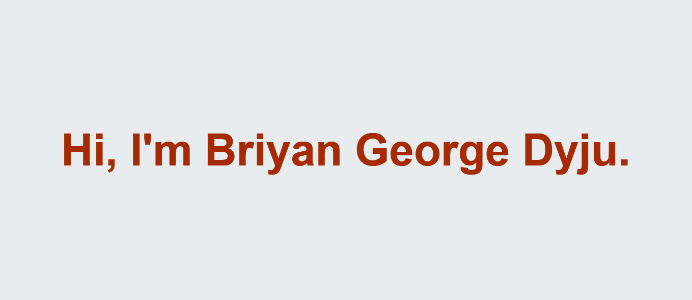
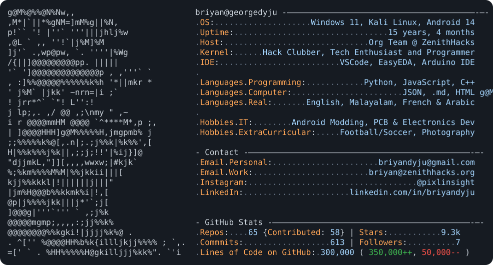

Student · Developer · Operations Associate [@Hack Club](https://hackclub.com/) · based in Dubai 🌆

---

### ✦ whoami

Hack Clubber, tech enthusiast, and programmer who likes building random things — apps, PCBs,
games, and the occasional bootloader. I make stuff I don't fully understand yet; that's the point.

- 🛠️ **Languages:** Python · JavaScript · Dart
- 💡 **Into:** app development · Android modding · PCB & electronics · photography
- 🌍 **Speak:** English · Malayalam · French · Arabic
- ⚡ **Fun fact:** sleep is a social construct

### ✦ stats

✦ stay curious ✧

